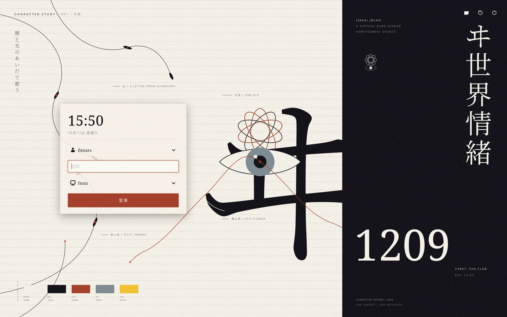

# joucho



The login screen for [inua](https://github.com/lyricat/inua), in inua's
look: a Wayland greeter for [greetd](https://github.com/kennylevinsen/greetd),
written in Go with GTK4 through the same bindings the shell uses
([puregotk](https://codeberg.org/puregotk/puregotk)) and dressed in the
shell's own colour themes (washi, yoru, aojashin, bunko, denko, rinko,
isekai, suimen). A [中文说明](README.zh_CN.md) is kept beside this file.

The name is the romanization of the Japanese 情緒, jōchō: emotion. The
`isekai` theme is drawn after the virtual singer
[ヰ世界情緒](https://kamitsubaki.jp/) (Isekaijoucho) of KAMITSUBAKI
STUDIO, and a login screen is where the machine meets the person. It is
a fan concept, not affiliated with the artist or the studio.

greetd does the display manager's job (it is small, has no UI of its own
and is packaged by every distribution); this program is its greeter: it
shows the card, asks PAM for the password through greetd's IPC protocol,
and greets the chosen session. A kiosk Wayland compositor, usually
[cage](https://github.com/cage-kiosk/cage), shows it full screen on the VT.

```
greetd  ──PAM──▶  password
   │  starts
   ▼
cage ──▶ joucho ──GREETD_SOCK──▶ greetd
                               │ authenticated
                               ▼
                        inua-session (Hyprland + inua-shell)
```

## Building and previewing

Needs Go 1.26 and the GTK4 libraries at run time (no cgo and no headers:
puregotk opens libgtk-4.so at run time).

```sh
go build -o joucho .
```

Preview it inside your running session — no greetd, no authentication:

```sh
./joucho --demo
./joucho --demo --theme yoru --text-scale 125
```

`--list` prints the users and sessions found and exits.

| Flag | What |
| --- | --- |
| `--config PATH` | settings file (default `/etc/joucho/config.toml`) |
| `--theme NAME` | colour theme, overrides `theme` |
| `--text-scale N` | 80 to 150, overrides `text_scale` |
| `--demo` | run in your session without greetd; no real authentication |
| `--sessions-dir DIRS` | where sessions are looked for, colon separated |
| `--list` | print the users and sessions found, then exit |
| `--render FILE` | draw the isekai composition to a PNG and exit |

## Installing

```sh
sudo scripts/install.sh
```

The script installs the packages if needed (`greetd`, `cage`), copies
the program to `/usr/local/bin`, writes `/etc/joucho/config.toml`,
replaces `/etc/greetd/config.toml` (keeping the old one as
`config.toml.~1~`), disables SDDM (or whichever display manager is
enabled) and enables greetd. Nothing is started or stopped: the session
on screen stays. `--no-dnf` skips the package step, for machines that
already have greetd and cage.

To see the login screen, reboot; or, from a TTY (Ctrl+Alt+F3):

```sh
sudo systemctl stop sddm && sudo systemctl start greetd
```

Back to SDDM: `sudo scripts/revert.sh`.

## Settings

`/etc/joucho/config.toml`, all defaults until changed (the greeter runs
as the greetd user and cannot read your home directory):

| Setting | Default | What |
| --- | --- | --- |
| `theme` | `"washi"` | a built-in theme (`washi`, `yoru`, `isekai`, …), or `themes/NAME.css` beside the config |
| `text_scale` | `100` | text size, 80 to 150 percent — the same meaning as inua's `style.text_scale`, and only font sizes scale |
| `language` | `"auto"` | `auto` (LANG), `en`, `zh_CN` |
| `user` | `""` | user to start on; empty picks the one who logged in last this boot |
| `session` | `"inua.desktop"` | session from `/usr/share/wayland-sessions` to start on |
| `wallpaper` | `""` | picture behind the card; empty uses the theme's field texture, as the shell's wallpaper does |
| `font` | `""` | window font; empty uses the built-in stack, the shell's own (Zen Kaku Gothic New, Noto Sans CJK JP/SC) |
| `power` | `true` | show suspend, restart and shut down (they ask logind; without permission it says so) |
| `clock_seconds` | `false` | show seconds in the clock |

A theme of your own goes in `/etc/joucho/themes/NAME.css`: the same
`@define-color` tokens as inua's, only the ones it changes; the rest
come from the theme it is based on. Copy one from the shell's
`~/.config/inua/themes/` (or from `assets/themes/` here) to start.

## The isekai theme

`theme = "isekai"` is not a colour swap. It draws the greeter as a
character study of ヰ世界情緒: paper and grain, the night panel on the
right with the ヰ and the vertical title, vines and a rust thread, the
eye-flower, the palette. The card sits on the paper, left of the mark.
The composition is fimars's own drawing (`decor.go`), in the concept's
1600 × 1000 units; `--demo --theme isekai` shows it at that size, and
`--render FILE` draws it with no display at all.

It is a fan concept. The on-screen credit names the character design and
says *not affiliated*; no official artwork is included, and the project
is not associated with the artist or KAMITSUBAKI STUDIO.

## Notes

- The greeter runs as the `greetd` user, which cannot see fonts, themes
  or pictures in your home directory. The built-in font stack is the
  shell's own and needs nothing installed besides the system's Noto CJK.
  If you set `font = "Family Name"` to a font that lives in your home,
  install it system-wide (`/usr/local/share/fonts`, then `fc-cache -f`);
  the greeter says so in greetd's log when the family cannot be found
  and falls back to the next in the stack.
- The power buttons call `org.freedesktop.login1`. Fedora's polkit policy
  usually lets the active session do this without a password; if it does
  not, the greeter says "No permission." and nothing else happens.
- greetd logs what the greeter prints:
  `journalctl -u greetd` (or `/var/log/greetd.log` on some systems).
- The greeter's account can read `/etc/passwd` and
  `/usr/share/wayland-sessions`, and nothing of yours; the password goes
  to greetd over its socket, PAM checks it, and the greeter keeps none of
  it.
- Portal warnings in `--demo` ("Cannot get portal …") are harmless: a real
  greeter session has no portals.
- If cage cannot take the DRM device under SELinux, say so with
  `journalctl -u greetd`; greetd's PAM session normally provides seat
  access.

## Development

```sh
go test ./...
go vet ./...
```

`--render FILE.png` draws the isekai composition without a display, one
concept unit to one pixel, with the card's footprint marked, so the
arrangement can be checked and nudged without fighting a compositor.

See [CONTRIBUTING.md](CONTRIBUTING.md) for how to send a change and
[CHANGELOG.md](CHANGELOG.md) for what has changed so far.

## License

joucho is under the Apache License 2.0; see `LICENSE`. It copies the
colour themes, the `scaleText` function and the field texture drawing
from [inua](https://github.com/lyricat/inua), also Apache-2.0; the
attribution is in `NOTICE`.
